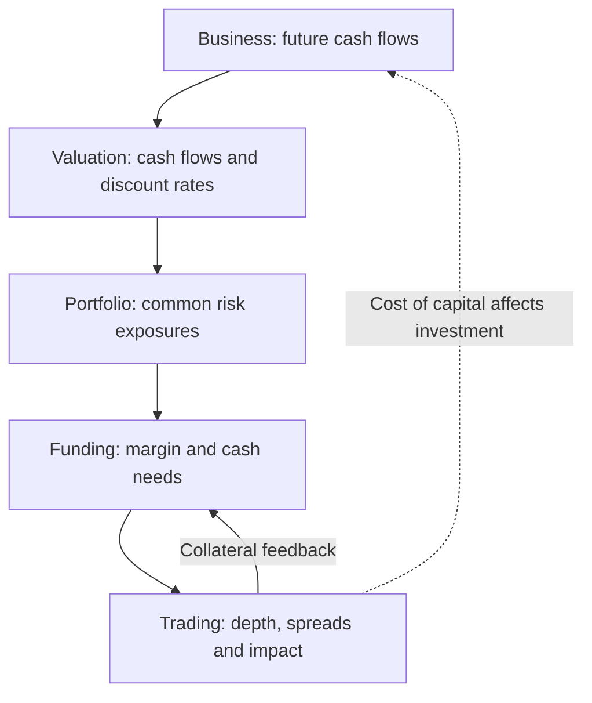

PE (price-to-earnings, 市盈率) , PB (price-to-book, PB, 市盈率) 

EV (enterpise value, 企业价值)

Model | key input | Main valnerability
----|-------|------------
DCF | Cash flows and discount rates | Forecast error; teriminal value
PE / PB | Earnings / book equity | Cyclical profits; assets quality
EV / EBITDA | Operating earnings proxy | Capex, working capital and cash taxes

## Market Factors Model

* factor return: 系统投资特征在一段时间里的表现如何
* factor exposure: 股票对这种特征的收益变化有多敏感

### CAPM 

CAPM (资本资产定价模型, Captial Asset Pricing Model) 观点是：投资者承担无法通过充分分散投资
消除的市场风险，因此应该获得相应的风险补偿。

$$E(R_i)-r_f = \beta_i[E(R_m)-r_f]$$

* $E(R_i)$ 该股票的预期收益率
* $r_f$ 无风险利率。$E(R_i) - r_f$ 是预期的超额收益。
* $E(R_m)$ 市场组合的预期收益率。 $E(R_m) - r_f$ 是市场风险溢价
* $\beta_i$ 股票对市场波动的敏感程度

### Fama-French Model (三因子模型)

$$R_i - r_f = \alpha_i + \beta_M MKT + \beta_S SMB + \beta_H HML + \epsilon_i$$

* $MKT = R_m - r_f$ 即市场风险溢价 
* $SMB$ (Small Minus Big) 投资组合里，小市值股票和大市值股票的差异 （小盘和大盘的表现差异)
* $HML$ (High Minus Low) 指账面市值比 (Book-to-Market Ratio)有明显差异的股票间的价格差异
* $\alpha$ 场外因素
* $\epsilon$ 随机残差

账面市值比 = 账面股东权益 / 股票市值

对于高账面市值比的企业，一般有更高的**价值股**特征；反之，则有**成长股**的特征。

后续，Fama-French 又加入了两个因子：
* $RMW$ 盈利能力 (Robust Minus Weak)，指高盈利组合 - 低盈利组合
* $CMA$ 投资因子 (Conservative Minus Aggressive) ，衡量公司自身的资产扩张和投资行为，指
    低资产增长组合 - 高资产增长组合

### Carhart Model （四因子模型)

额外加入了 **动量因子 (Momentum)** ，指过去的表现有一定的持续性，过去表现好，现在
相对跑赢的概率也大。

## Workflow 

分析一条策略，可依次检查：
1. payoff      谁承诺什么，在什么状态下支付
2. pricing     定价受现金流、无风险利率还是风险溢价决定？
3. equilibrium 哪些参与者愿意持有风险，需要什么补偿？
4. constraints 谁需要保证金，谁不能等待？谁不能卖？
5. evidence 

