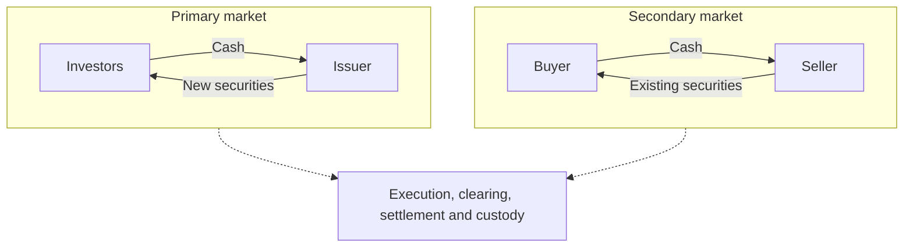

## Market

一级市场 (primary market) 发行新证券，二级市场 (secondary market) 转让既有证券，。

**经纪商 (Broker)** 撮合买卖双方，替用户执行交易；
**做市商 (dealer)** 以自由账户买卖证券，以自身资产负债表（流动性）承接库存风险。
基金经理受委托管理资产 (委托代理, principal-agent) 

## 市场风险

* Credit Risk. Borrower may fail to repay
* Liquidity Risk. Cannot sell assets into cash quickly
* Market Risk. Assets value changes due to rate monvements
* Inflation Risk.

## 交易

 买价 (bid) 是别人愿意买的价格，卖价 (ask) 是别人愿意卖的价格。差价称为 **买卖差价 (bid-ask spread)**

 * **市价单 (market order)** 要求立即执行
 * **限价单  (limit order)** 限制可接受价格，但可能无法成交

## Glossory

$N$ 名义本金 (Notional)

$M$ 到期兑付额度 (Maturity redemption quota)

$T$ 总期限 (Tenor)

$C_i$ 在 $T_i$ 收到的现金流

$D(t, T)$ 折现因子 (discount factor, DF), 在 $t$ 时购买 $T$ 时的 \$1 所需的价格

Day-count convention. 计息天数规则. 如 ACT/360 用 $\alpha = \frac{d}{360}$, ACT/365 用
$\alpha = \frac{d}{365}$ 

Spot, fixing, accrual start, payment date. 即期交割日 (一般 T+2)、定盘日 (确定浮动利率或汇率的日期)、
计息起始日 (利率开始累计的日期)、付款日 (实际收付资金的日期)。

$S, c, p, q, \sigma$ 现货、看涨价格、看跌价格、连续股息率、年华波动率

Eurocurrency: offshore US dollar 

Basis Point (基点, bp) ，1bp = 0.01%

Mark-to-Market (MTM, 盯市) 按当前市场价格，重新计算持仓的价值和盈亏，而不是按买入价计价 

Break-even 盈亏平横

Level payments. 等额付款。
