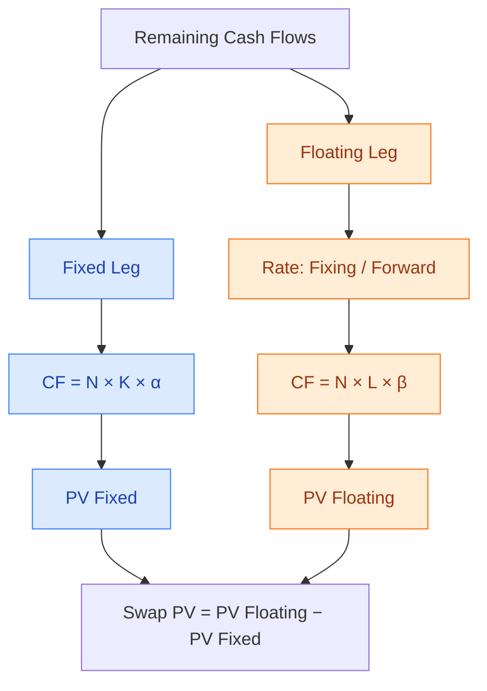

## Forward Rate (远期利率)

根据**无套利原则 (No-Arbitrage Principle)** ，直接投资 $T_2$ 到期的零息债券：

$$N \times D_2$$

与先投资到 $T_1$ 的零息债券，再按 $T_1$ 时某种锁定的远期利率 $F$ 投资到 $T_2$ 

$$N \times D_1 \times \frac{1}{1+\alpha F_{1,2}}$$

应该得到相同的终值，即：

$$1+F_{1,2}\alpha=\frac{D(0,T_1)}{D(0,T_2)}$$

* $D(0, T_i)$ 今天到 $T_i$ 的折现因子。即 $T_i$ 的 \$1 折现到今天的价值
* $F_{1,2}$ 是从 $T_1$ 到 $T_2$ 的远期年化利率
* $\alpha$ 是远期区间 $[T_1, T_2]$ 计息年分数

## FRA (Forward Rate Agreement, 远期利率协议)

3x6FRA 是指：在三个月后开始的为期三个月的远期利率。
* $T_0$ 是今天。锁定*合约固定利率* $K$ 
* $T_1$ 是3个月后，传统 FRA 在此时**定盘 (fixing)** 并取得市场参考利率 $L$ ，进行现金结算 
    (cash settlement in advance)。此时期末利差为 $N\alpha (L-K)$，但是要折现到 $T_1$ 完成交易
* $T_2$ 是6个月后，存款结束。

$$settlement_{T_1} = N \alpha (L-K)\cdot D(T_1, T_2) =  N \alpha \frac{L - K}{1 + L \alpha}$$

Buy FRA -> pay fixed, receive floating -> expect i $\uparrow$  
Sell FRA -> receive fixed, pay floating -> expect i $\downarrow$

FRA 只在约定日期结算一次，OTC 市场；而 Futures 则是每日结算，在交易市场 (Exchange) 交易。

## SIRF (Short-term Interest Rate Futures, 短期利率期货)

短期利率期货通常采用： Futures Price = 100 - Interest Rate. [^1]

[^1]: 例子见 [Appendix A](#sirf-example)

也就是说，做空期货 (Short IRF)，等于做多利率 (Long FRA)：

Buy Futures -> expect Future Price $\uparrow$ -> i $\downarrow$ (effectively = sell FRA)  
Sell Futures -> expect Future Price $\downarrow$ -> i $\uparrow$ (effectively = buy FRA)

BPV (Basis point value) 就是指 1bp 所对应的价值，对应利率为 $0.01% = 10^{-4}$ 。
假设计息比例 $\alpha$ ，名义本金 (Notional) $N$。使用简单利息 $\text{Interest} = N\alpha \times R$
，那么利率每上升 $1 bp$，需要额外付出的利息就是 Spot BPV。

要对冲利率变化，需要购买的期货数量为：

$$n \approx \frac{\text{Spot BPV}}{\text{Futures BPV}}\quad \text{Spot BPV} = N \alpha \times 10^{-4}$$

## IRS (Interst rate swap, 利率互换)

Swap 有两个 Legs。同币种的 IRS 一般只考虑利息不考虑本金。以收浮动、付固定为例：
* Fixed leg 按合同固定利率 $K$ 付息 $N K \alpha_i$ 
* Floating leg 按市场浮动利率 $F_i$ 收息 $N F_i \beta_i$

估值时需要折现：固定方每期累积折现： [^3]

$$PV_{\text{fixed}}=N\times K\sum_i\alpha_iD(t,T_i)$$

[^3]: $A_t=\sum_i\alpha_iD(t,T_i)$ 也被称为年金因子 (annuity factor)，是固定方每单位票息的现值

浮动方：[^4]

$$
PV_{\text{float}}=N\sum_i F_i \alpha_i D(t,T_i) 
$$ 

[^4]: 在单曲线假设下，$\alpha_i F_i  D_i = D_{i-1} - D_i$,
    因此 $PV_f =N \sum_{i=1}^n (D_{i-1}-D_i) = N(D_0 - D_n)$. 这也被称为望远镜求和 (telescoping sum)

Swap 的总价值：

$$V=PV_{\text{float}}-PV_{\text{fixed}}$$

### Par Swap Rate (平价互换利率)

签订互换时，希望合同价值为零，即希望两方现值相等：

$$PV_\text{float}=PV_\text{fixed}$$

解出合理的固定利率：

$$
K^*=\frac{\sum_{i=1}^{n}\alpha_i D_iF_i}{\sum_{i=1}^{n}\alpha_i D_i}
$$

这个 $K^*$ 实际隐含了市场的远期利率 (Forward Rates)，是未来各期远期利率的折现加权平均。

### IRS Flowchart

## Hedging FRA with Futures

## Appendix

### SIRF Example 

