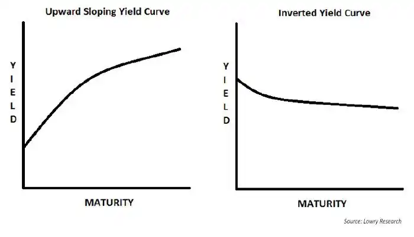

## Money Market

The money market is the term used to include all **short-term** financial instruments
which are baed on a *interest rate*.

### Yield Curve

## Money Market Instruments

Money Market 工具属于短期、低风险、高流动性货币工具，短期内借钱来服务于流动性。  
Derivatives 则主要是钱生钱工具，建立在底层工具之上。

Govern or Municipal Debt:  

* Treasury Bill (T-bill, 国库券) (Bill 票据),  政府发债。极低风险和极高流动性。

Bank Debt:

* Time Deposit (定期存款), 银行借钱，一般不可交易或无代价撤销。
* Certificat of Deposit (CD, 大额可转让存单, 存款证), 银行借钱，固定利率和时间。
* Pepurchase Agreement (Repo, 回购协议), 用证券抵押 (Secured) 来借钱。
* Fed Funds (Interbank, 银行间拆借)，用于管理准备金

Corporate Debt:

* Commercial Paper (CP, 商业票据), 公司借钱，风险高一些。
* ~~Corporate bonds (not included in monney market)~~

Foreign Exchange Instruments:

* FX Swaps, Exchange of currencies today with a reverse exchange at a future date.

## Yield vs. Discount quote (收益率报价与贴现率报价)

Yield 和 Discount rate 都是描述金融工具的回报。

Yield 以实际购买价格衡量。设本金为 $P$ ，到期价格为 $M$ (Maturity Value)

Yield = ( M - P ) / P 

Dicount Rate 以*面值 (Face Value / Par Value)*衡量

Discount rate = (Par - P) / Par

工具 | 兑付价格 | 计价方式
---- | ----  | ---- 
Bill (yield y) | $P = M / (1 + y \tau)$ | 单利收益率
dicount rate d | $P = M (1 - d \tau)$ | 以面值计算折价
CD (Primary Market) | $M = N (1 + c \tau_0)$ | 类似定期存款凭证，有兑付额
CD (Secondary Market) | $P_t = M / (1 + y_t \tau_r)$ | 按剩余期限和市场收益率再重新估价

### Repo (回购协议, Repurchase agreement)

现金借入方今天卖出证券、约定未来买回，以此取得有抵押融资。**抵押品 (collateral)** 的市值
需要经过折扣 (haircut) 后决定可融资金额。

## Money Market Derivatives

*Futures* (期货):   
a contract to but/sell an asset at a specified price on a future date.
The underlying asset is usually: govn bonds, stock index, interest rates, commodity. 

[*FRA (Forward Rate Agreement)*](./forward-rate.md):  
an OTC (场外交易) forward contract that locks in an interest rate for a future period. 

[*Options*](./options.md):   
Calls & Puts 

[*Swaps*](./swaps.md):

## RR (Risk-Free Rate)

### US SOFR (Secured Overnight Financing Rate)

* Secured: 有美国国债作抵押
* Overnight：当日隔夜利率
* Transaction-based: 基于实际市场交易

由于每日结算利率，因此每期存款利率不能提前知晓，需要累计每日隔夜利率（复利计算），到期末确定最终利息。

### CN DR007 & FR 007

境内人民币的利率基准不适用 LIBOR，不同市场有不同基准（利率基准不统一）：

* 7D Reverse Repo Rate: 央行政策利率
* DR007: 银行间市场利率。存款类机构7天质押式回购加权平均利率
* FR007: 银行间7天回购定盘利率
* LPR: 贷款市场报价利率

