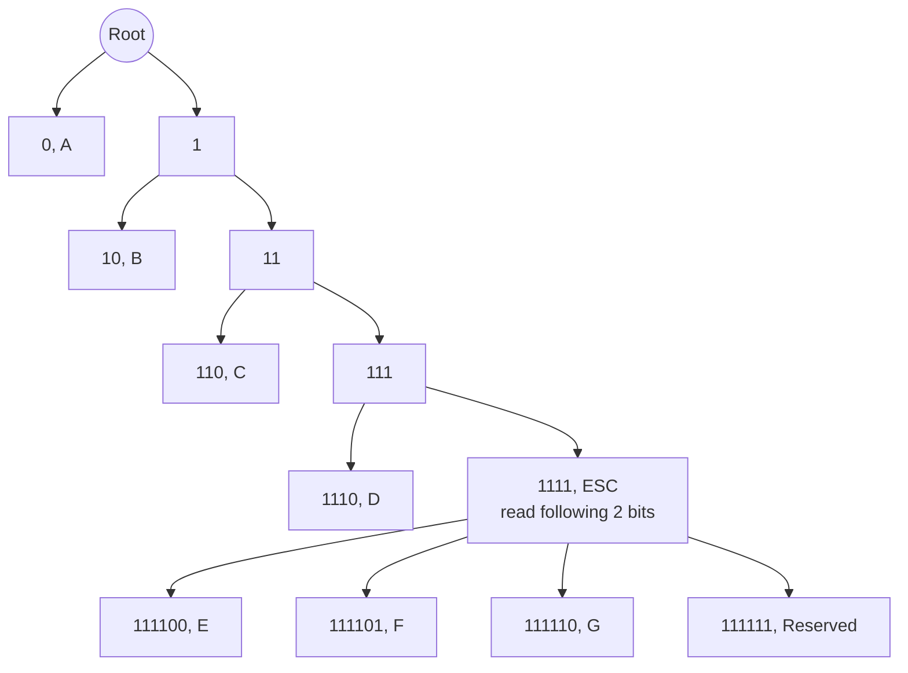

## 哈夫曼 (Huffman) 编码

通过构建二叉树来编码: (自底向下)
1. 为每个符号创建一个节点, 权值为其出现概率.
2. 按权值从小到大排序节点, 使用优先队列存储.
3. 构建树:
	- 选出权值最小两个节点
	- 创建新内部节点, 作为这两个节点父节点, 其权值为两子节点权值和.
	- 将新节点添加回优先队列, 重新排序
	- 重复该过程, 直至只剩根节点.
4. 分配码字, 从根开始, 向左分配0, 向右分配1.

使用二叉树译码, 顺序读入二进制编码, 从 root 开始, 对于每个编码:
- 读1进入左子树
- 读0进入右子树
- 若到达叶子节点, 则译出一个符号.

## Truncated Huffman Coding

Huffman Coding 只能约束平均编码长度 $\sum p_i l_i$ 最小，但是可能出现**低频符号的编码长度
非常长**的问题。Huffman Coding 要求编码必须是**前缀无歧义 (Prefix-free)** 的，在按符号概率
构建树时，容易出现非常不平衡的树。

Huffman Coding 在无明确分隔符的情况下，对二进制码进行编码。Truncated Huffman Coding 则将
所有低频符号合并到某个符号（以 `ESC` 为例），每当读取 `ESC` 时，向后读取一个固定长度。所有
低频符号都编码在这个固定长度里。

